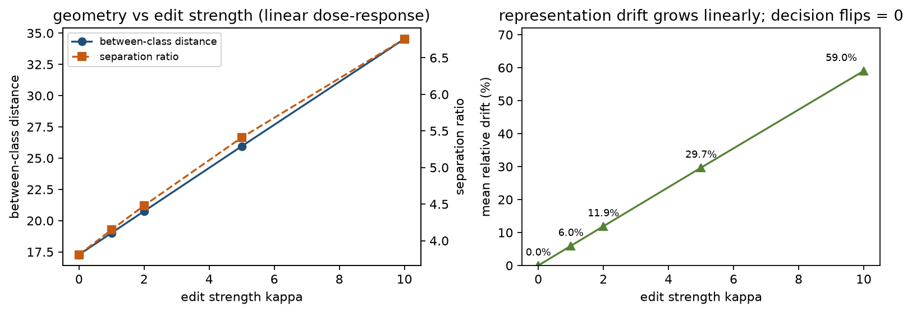

# LLM-directed weight-space programming on a network encoder

**Author:** Abdul Rauf · **Status:** complete experiment, results frozen · **Model:** snlucsb/netFound-small

Can a language model edit the weights of a pretrained neural network directly — no gradients,
no optimiser, no fine-tuning — and *predict* what the edit will do to the network's
representations?

This repository is the full experimental record of that question, run on
[snlucsb/netFound-small](https://huggingface.co/snlucsb/netFound-small), a 53.4M-parameter
hierarchical transformer for network traffic.

**Short answer:** yes for geometry, no for decisions. A closed-form rank-1 edit of a single
tensor doubles the between-class distance in the encoder's flow representations, with a
linear dose-response — and changes *zero* classifications under a fixed nearest-centroid
readout, because the edit scales the class means and their ambiguous members together.

---

## Research question

Weight-space programming (WSP) is the idea that a model can read and write another model's
weights as a program. The practical claim to test is not "can weights be modified" — that is
trivial — but "can a proposed modification be *predicted* and *measured*", and at which level
of description the prediction holds: weights, representations, or behaviour.

We therefore separate four levels and report on each independently:

1. **weight-space intervention** — what was edited, how many parameters, with what norm;
2. **representation geometry** — between-class distance, within-class dispersion,
   separation ratio, per-flow drift;
3. **downstream classification** — macro F1, precision, recall, FPR, AUC, confusion matrix
   under a fixed, untrained nearest-centroid readout;
4. **capability acquisition** — deliberately *not* claimed (see the validity section).

## Findings

| condition | macro F1 | FPR | between-class | separation ratio | drift | decision flips |
|---|---|---|---|---|---|---|
| original checkpoint | 0.9889 | 0.0367 | 17.28 | 3.81 | 0 | — |
| rank-1, kappa=1 | 0.9889 | 0.0367 | 19.02 | 4.15 | 6.0% | 0 |
| rank-1, kappa=2 | 0.9889 | 0.0367 | 20.76 | 4.48 | 11.9% | 0 |
| rank-1, kappa=5 | 0.9889 | 0.0367 | 25.95 | 5.41 | 29.7% | 0 |
| rank-1, kappa=10 | 0.9889 | 0.0367 | 34.54 | 6.76 | 59.0% | 0 |
| single-unit (512 values) | 0.9889 | 0.0367 | 15.40 | 3.42 | 6.2% | 0 |
| negative control | 0.9889 | 0.0367 | 17.28 | 3.81 | 1.7e-8 | 0 |

* Geometry is controllable and **linear** in edit strength: between-class distance =
  17.28 + 1.727 kappa (R^2 = 0.9999), drift = 5.90 kappa %.
* All classification numbers are **identical** to the original, including the confusion
  matrix (TP 2001 / FP 14 / TN 367 / FN 0) and the paired-bootstrap difference
  (0.0000, 95% CI [0.0000, 0.0000]).
* The mechanism is measurable: the 14 ambiguous benign flows move 47-48% as far as scans
  at every strength, tracking the scan centroid, so their decision margin never flips sign.
* The negative control (a tensor off the readout path) moves nothing: drift 1.7e-8.

## The model

[netFound-small](https://huggingface.co/snlucsb/netFound-small) encodes a *flow* as up to 12
*bursts* of up to 6 packets, each packet 12 header tokens (IP TTL, TCP flags/window/seq/ack,
...). Per layer: a RoPE attention + GLU MLP **burst encoder** over packets, a flow-position
embedding, then the same block as a **flow encoder** over bursts. 4 layers, 4 heads, hidden
512. Two structural facts matter here:

* the tokenizer **discards ports and IP addresses**, so a single flow cannot carry the fields
  that define a port scan;
* `lm_head.decoder.weight` is tied to `word_embeddings.weight`, and the four
  `position_embeddings` are one shared tensor — patches must respect both.

Full inventory, per-tensor statistics and the parameter budget:
[docs/01_architecture_and_tensors.md](docs/01_architecture_and_tensors.md).

## The corpus, and why no capability claim is made

Labels come from [CTU-IDSEVAL-6](https://zenodo.org/records/21027042): one benign user-traffic
capture and three port-scan captures, 761 benign and 133,347 scan TCP flows after conversion.

The corpus is separable by host/network fingerprint alone:

| single feature | AUC | scan | benign |
|---|---|---|---|
| IP TTL | 1.000 | 37-59 | 128 (all) |
| TCP window | 1.000 | 1024 | 8192 |
| IP total length | 1.000 | 40-44 | 48-52 |

A one-line rule (`ttl < 64`) scores macro F1 = 1.0000, FPR = 0.000. No classifier evaluated on
this corpus can demonstrate port-scan detection; it can only demonstrate fingerprint
exploitation. The benchmark is therefore used **only** as a controlled testbed for
representation-geometry interventions — see
[docs/02_dataset_and_baseline.md](docs/02_dataset_and_baseline.md).

## The interventions

Six independent patches, each applied to its own checkpoint copy; the original checkpoint is
never written. All statistics are closed-form means of support-set activations — there is no
gradient anywhere in this repository.

| patch | tensor | shape | edit | values changed | % of model |
|---|---|---|---|---|---|
| `p1a-k1` | `encoder.layer.3.burst_encoder.mlp.Wo.weight` | 512x768 | dW = 0.1098 u v^T | 393,149 | 0.7364 |
| `p1a-k2` | same | 512x768 | dW = 0.2196 u v^T | 393,186 | 0.7365 |
| `p1a-k5` | same | 512x768 | dW = 0.5491 u v^T | 393,205 | 0.7366 |
| `p1a-k10` | same | 512x768 | dW = 1.0982 u v^T | 393,212 | 0.7366 |
| `p2-single-unit` | same | 512x768 | one column (unit 656) | 512 | 0.0010 |
| `p3-control` | `attentivePooling.lin_proj.weight` | 512x512 | x1.05 | 262,144 | 0.4911 |

`u` (512-d) and `v` (768-d) are unit vectors: `u` = mean final-hidden(scan) - mean
final-hidden(benign), `v` = the same in the layer-3 MLP hidden space. `kappa` sets the mean
token displacement along `u`. A rank-1 patch has 1,279 intrinsic degrees of freedom despite
rewriting 393k values.

## Retain / reject

| patch | decision | reason |
|---|---|---|
| `p1a-k1`, `p1a-k2` | retain as geometry-control instruments | clean dose points, regression within tolerance |
| `p1a-k5` | retain with caveat | swapped-burst loss +11% |
| `p1a-k10` | reject | MLM top-1 -0.10 pp, swapped-burst loss +21.6%, no decision benefit |
| `p2-single-unit` | retain as minimal-footprint datapoint | 512 values, contraction direction |
| `p3-control` | retain as negative control | exact zero effect, validates the harness |

Detailed report: [docs/03_interventions.md](docs/03_interventions.md).

## Repository layout

    docs/                  architecture, dataset/validity, interventions, reproduction
    patches/               the six patch JSONs (plus a no-op self-test patch)
    patches/manifests/     per-tensor delta manifests written at apply time
    tools/                 the exact scripts used (paths resolved from $WSP_ROOT)
    results/               per-condition JSON, per-flow predictions, CSV tables
    scripts/               environment setup helper
    data/                  dataset card and download instructions (no traffic data shipped)

## Reproducing

Requirements: Python 3.10-3.12, ~2 GB disk for the checkpoint, CPU is sufficient.
(We used a self-contained CPython 3.12 because the host's 3.15 has no `pyyaml`/`datasets`
wheels; see [docs/04_reproduction.md](docs/04_reproduction.md).)

    pip install torch transformers==4.57.3 datasets numpy safetensors scapy pandas tensorboard psutil

    # 1. model code + checkpoint
    git clone https://github.com/SNL-UCSB/netFound vendor/netFound
    huggingface-cli download snlucsb/netFound-small --local-dir checkpoints/original
    # sha256 must be 9e0080bbf00f6cd54e1394eb7ad484dd3f5b0758404c80d9ac91a77243e06a70

    # 2. dataset (CTU-IDSEVAL-6, Zenodo 21027042) -> data/ctu/pcap/pcap/*.pcap
    #    then convert pcaps to netFound flow records
    python tools/build_dataset.py "data/ctu/pcap/pcap/*.pcap" data/flows_tcp.jsonl

    # 3. baseline embeddings + geometry
    python tools/embed_all.py
    python tools/make_original_result.py

    # 4. apply a patch and evaluate (repeat per patch id)
    python tools/eval_patch.py p1a-k5-rank1-wow

    # 5. comparison, geometry CIs, regressions
    python tools/compare.py
    python tools/geometry_bootstrap.py
    python tools/run_regressions.py orig p1a-k1-rank1-wow p1a-k2-rank1-wow p1a-k5-rank1-wow \
        p1a-k10-rank1-wow p2-single-unit p3-control-pooling

Every script resolves paths from `$WSP_ROOT` (defaults to the repository root), so the
repository itself can be the working directory. Patch application is atomic and reversible:
`tools/patch.py` writes a new directory under `checkpoints/patched/<patch_id>/`, never the
base checkpoint, and records per-tensor delta L2 and relative L2 in `patch_manifest.json`.

Runtime on a 4-core CPU: ~11 min per patch evaluation, ~1-2 min per regression run,
~1 min for the bootstrap analyses.

## Tests

    pytest -q

Thirteen tests that need neither torch, the checkpoint nor the dataset: the patch engine
must reject unknown tensors, wrong shapes, non-finite values and bad rank-1 dimensions,
must leave the base checkpoint bit-identical, and an identity patch must produce a
byte-identical copy; the committed result tables must keep showing zero decision changes,
a monotone geometry ladder and an exact negative control.

## Data and licences

* Model: `snlucsb/netFound-small`, MIT, (c) SNL UCSB.
* Upstream code: [SNL-UCSB/netFound](https://github.com/SNL-UCSB/netFound), MIT (not vendored here).
* Dataset: [CTU-IDSEVAL-6](https://zenodo.org/records/21027042), Zenodo record 21027042;
  no traffic data is redistributed in this repository, only derived statistics.
* This repository's code and text: MIT (see LICENSE).

## Citation

    @misc{llm_directed_wsp_netfound_2026,
      title  = {LLM-directed weight-space programming on a network encoder},
      author = {Rauf, Abdul},
      year   = {2026},
      note   = {Closed-form representation-geometry interventions on snlucsb/netFound-small},
      url    = {https://github.com/raufnarejo505/llm-directed-weight-space-programming}
    }

## Base checkpoint

    snlucsb/netFound-small  model.safetensors
    sha256  9e0080bbf00f6cd54e1394eb7ad484dd3f5b0758404c80d9ac91a77243e06a70
    size    213,551,820 bytes   132 tensors   53,383,495 parameters (F32)
